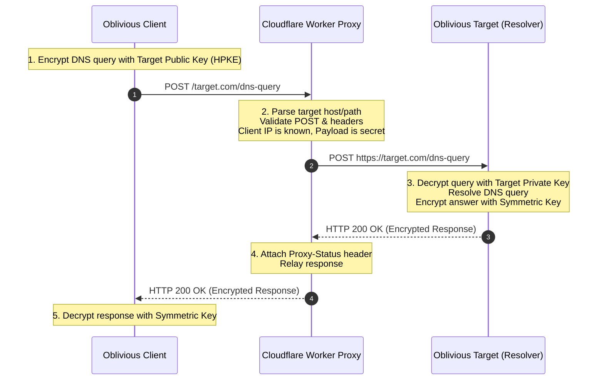

# Oblivious DNS-over-HTTPS (ODoH) Proxy on Cloudflare Workers

An ultra-fast, privacy-preserving **Oblivious DNS-over-HTTPS (ODoH) Proxy** implementation compliant with [RFC 9230](https://datatracker.ietf.org/doc/rfc9230/), designed specifically to run on [Cloudflare Workers](https://workers.cloudflare.com/).

A Cloudflare Workers endpoint (proxy) to an upstream Oblivious DNS-over-HTTPS target.

---

## Table of Contents

1. [Overview](#overview)
2. [DoH vs. ODoH: Why Oblivious DNS?](#doh-vs-odoh-why-oblivious-dns)
3. [Architecture & Threat Model](#architecture--threat-model)
4. [Cryptographic Encapsulation & Packet Layers](#cryptographic-encapsulation--packet-layers)
5. [Step-by-Step Packet Flow](#step-by-step-packet-flow)
6. [Supported Endpoint URIs & Routing](#supported-endpoint-uris--routing)
7. [Cloudflare Workers Runtime Nuances & Forwarding Modes](#cloudflare-workers-runtime-nuances--forwarding-modes)
8. [Sequence & Flow Diagrams](#sequence--flow-diagrams)
9. [Deployment & Usage](#deployment--usage)

---

## Overview

[RFC 9230](https://datatracker.ietf.org/doc/rfc9230/) defines **Oblivious DNS-over-HTTPS (ODoH)**. An **Oblivious Proxy** is a specialized HTTP server that forwards encrypted DNS messages between an **Oblivious Client** and an **Oblivious Target**.

As identified by a URI Template as in [RFC6570](https://datatracker.ietf.org/doc/rfc6570) (see Section 4.1). *Oblivious Proxy* is not a full HTTP proxy but a specialized server that forwards Oblivious DNS messages.

The Proxy acts as a privacy shield:
* The Proxy sees **WHO** is making the request (Client IP address) but **NOT WHAT** is being requested (the DNS query is encrypted using the Target's HPKE public key).
* The Target sees **WHAT** is being requested (DNS query) but **NOT WHO** requested it (the request originates from the Proxy's IP address).

As long as the Proxy and Target do not collude, user DNS privacy is mathematically guaranteed.

---

## DoH vs. ODoH: Why Oblivious DNS?

| Feature | Standard DoH ([RFC 8484](https://datatracker.ietf.org/doc/rfc8484/)) | Oblivious DoH ([RFC 9230](https://datatracker.ietf.org/doc/rfc9230/)) |
| :--- | :--- | :--- |
| **Transport** | Client $\rightarrow$ DoH Server (Single TLS connection) | Client $\rightarrow$ Proxy $\rightarrow$ Target (Two distinct TLS connections) |
| **Server Visibility** | Resolving server sees Client IP **AND** DNS queries | Target sees DNS queries, Proxy sees Client IP (Separation of knowledge) |
| **Payload Encryption** | Transport TLS only (Server can read plaintext DNS) | **Dual Encryption**: Transport TLS + End-to-End HPKE Payload Encryption |
| **Privacy Guarantee** | Trust-based (DoH resolver promises not to log IP) | Cryptographic (Proxy cannot decrypt, Target cannot see IP) |
| **Content-Type** | `application/dns-message` | `application/oblivious-dns-message` |
| **HTTP Method** | `GET` or `POST` | `POST` (Mandatory for RFC 9230) |

---

## Architecture & Threat Model

```
        --- [ Request encrypted with Target public key ] -->
   +---------+             +-----------+             +-----------+
   | Client  +-------------> Oblivious +-------------> Oblivious |
   |         <-------------+   Proxy   <-------------+  Target   |
   +---------+             +-----------+             +-----------+
       <-- [   Response encrypted with symmetric key   ] ---
```

### Roles and Responsibilities

1. **Oblivious Client**:
   * Fetches the target resolver's ODoH Public Key Configuration (via HTTPS or DNS SVCB/HTTPS records).
   * Encrypts the raw DNS wire-format query using **HPKE** (Hybrid Public Key Encryption, RFC 9180).
   * Wraps the encrypted binary payload in an HTTP `POST` request sent to the **Proxy**.

2. **Oblivious Proxy (This Worker)**:
   * Validates the incoming HTTP request (`POST`, headers, target destination parameters).
   * Strips identifying client headers or forwards only safe headers to the target host.
   * Relays the encrypted HTTP payload to the **Target**.
   * Relays the encrypted response from the Target back to the Client.
   * **Crucial constraint**: The Proxy **does not possess** the Target's private key and **cannot decrypt** the DNS query or response.

3. **Oblivious Target**:
   * Receives the HTTP `POST` request from the Proxy (seeing the Proxy's IP address, not the Client's).
   * Decrypts the HPKE payload using its private key to extract the raw DNS query.
   * Resolves the DNS query.
   * Encrypts the DNS response using the symmetric key derived during HPKE key exchange.
   * Returns the encrypted HTTP response to the Proxy.

---

## Cryptographic Encapsulation & Packet Layers

ODoH uses a nested encapsulation model. Below is the breakdown of how a packet is constructed and decrypted as it travels through the network:

```
+-------------------------------------------------------------------------------+
| LAYER 1: Transport Layer (Outer HTTPS / TLS 1.3)                               |
|   - Client <-> Proxy TLS Tunnel (Protecting IP connection to Cloudflare)       |
|                                                                               |
|   +-----------------------------------------------------------------------+   |
|   | LAYER 2: HTTP Message Container (RFC 9230)                            |   |
|   |   - Method: POST                                                      |   |
|   |   - Content-Type: application/oblivious-dns-message                   |   |
|   |   - Headers: Host, Proxy-Status, etc.                                 |   |
|   |                                                                       |   |
|   |   +---------------------------------------------------------------+   |   |
|   |   | LAYER 3: Inner HPKE Encrypted Message Payload (RFC 9180)       |   |   |
|   |   |   - HPKE Key Identifier / Key ID                              |   |   |
|   |   |   - Key Exchange / KEM Encapsulated Key                       |   |   |
|   |   |   - Ciphertext (AEAD Encrypted Payload)                       |   |   |
|   |   |                                                               |   |   |
|   |   |   +-------------------------------------------------------+   |   |   |
|   |   |   | LAYER 4: Plaintext DNS Wire Format Message (RFC 1035) |   |   |   |
|   |   |   |   - ID, Flags, Question (e.g. A example.com)          |   |   |   |
|   |   |   +-------------------------------------------------------+   |   |   |
|   |   +---------------------------------------------------------------+   |   |
|   +-----------------------------------------------------------------------+   |
+-------------------------------------------------------------------------------+
```

### What Each Node Sees:

* **Client**: Sees layers 1, 2, 3, and 4 (it built them all).
* **Proxy (Cloudflare Worker)**: Terminates Outer TLS (Layer 1) and inspects HTTP Headers (Layer 2). **Cannot access Layer 3 or 4**.
* **Target**: Terminates Outer TLS (Layer 1 from Proxy), reads HTTP Headers (Layer 2), decrypts Layer 3 using private key to obtain Layer 4 (Raw DNS Query).

---

## Step-by-Step Packet Flow

Here is the exact lifecycle of a request:

### 1. Client Initialization
1. The Client retrieves the **ODoH Target Config** containing `key_id`, `kem_id`, `kdf_id`, `aead_id`, and `public_key`.
2. Client generates an HPKE key pair context and encrypts the raw DNS message (`application/dns-message`).
3. The resulting binary data forms an `application/oblivious-dns-message`.

### 2. Request: Client $\rightarrow$ Proxy
* **Transport**: HTTPS GET/POST connection over TLS 1.3 from Client IP `203.0.113.5` to Cloudflare Worker `odoh-proxy.example.workers.dev`.
* **HTTP Details**:
  ```http
  POST /dnstarget.example.net/dns-query HTTP/1.1
  Host: odoh-proxy.example.workers.dev
  Content-Type: application/oblivious-dns-message
  Accept: application/oblivious-dns-message
  Content-Length: 148

  [148 bytes of HPKE Encrypted Binary Data]
  ```

### 3. Proxy Processing (Cloudflare Worker)
1. Cloudflare Worker receives the request on its edge server.
2. Extracts target details (`targethost`: `dnstarget.example.net`, `targetpath`: `/dns-query`).
3. Verifies method is `POST`.
4. Constructs an upstream subrequest `https://dnstarget.example.net/dns-query`.
5. Sets/ensures headers:
   * `Content-Type: application/oblivious-dns-message`
   * `Accept: application/oblivious-dns-message`
   * `Cache-Control: no-cache, no-store`

### 4. Request: Proxy $\rightarrow$ Target
* **Transport**: HTTPS TLS 1.3 connection originating from Cloudflare Edge IP (`162.158.x.x`) to Target (`dnstarget.example.net`).
* **HTTP Details**:
  ```http
  POST /dns-query HTTP/1.1
  Host: dnstarget.example.net
  Content-Type: application/oblivious-dns-message
  Accept: application/oblivious-dns-message
  Content-Length: 148

  [148 bytes of HPKE Encrypted Binary Data]
  ```
* **Notice**: Target receives connection from Cloudflare Edge IP, not `203.0.113.5`.

### 5. Target Resolution & Response Generation
1. Target decrypts HPKE payload.
2. Target processes raw DNS query (e.g., looks up `example.com A`).
3. Target encrypts DNS response using the derived symmetric key.
4. Target returns HTTP 200 OK with encrypted payload.

### 6. Response: Target $\rightarrow$ Proxy $\rightarrow$ Client
* **Target to Proxy**:
  ```http
  HTTP/1.1 200 OK
  Content-Type: application/oblivious-dns-message
  Cache-Control: no-cache, no-store

  [Encrypted DNS Response Binary Data]
  ```
* **Proxy to Client**:
  The Worker attaches RFC 9230 `Proxy-Status` header and returns response to Client:
  ```http
  HTTP/1.1 200 OK
  Content-Type: application/oblivious-dns-message
  Proxy-Status: RethinkDNS; received-status=200
  x-orig-hdr-count: 3

  [Encrypted DNS Response Binary Data]
  ```

---

## Supported Endpoint URIs & Routing

This Worker supports two URL formats for defining the Target:

### Format A: Query Parameters
```
https://<proxy-host>/dns-query?targethost=<target-domain>&targetpath=<target-path>&fwd=<fwd-mode>
```
**Example**:
`https://odoh-proxy.workers.dev/dns-query?targethost=odoh.cloudflare-dns.com&targetpath=/dns-query`

### Format B: Path Parameters
```
https://<proxy-host>/<targethost>/<targetpath>/<fwd-mode>
```
**Examples**:
* `https://odoh-proxy.workers.dev/odoh.cloudflare-dns.com/dns-query`
* `https://odoh-proxy.workers.dev/odoh.cloudflare-dns.com/dns-query/0`

---

## Cloudflare Workers Runtime Nuances & Forwarding Modes

Cloudflare Workers execute on V8 isolates across Cloudflare's global edge network. When proxying requests in Cloudflare Workers, handling subrequests and response streams has critical nuances.

This worker provides three forwarding (`fwd`) modes:

### Mode 0: `FWD_STREAMED` (Default - High Performance)
* **Mechanism**: Passes the incoming `request.body` directly to the `fetch()` subrequest as a ReadableStream.
* **Pros**: Lowest memory usage and latency; streams bytes as they arrive.
* **Nuance**: Streams cannot be re-read if a subrequest fails or encounters an HTTP redirect.

### Mode 1: `FWD_CLONED`
* **Mechanism**: Uses `new Request(target, req)` to clone the request wrapper.
* **Pros**: Preserves original headers and metadata.
* **Nuance**: If the target server responds with a redirect (3xx status), Workers fetch handler handles redirects, but method/headers may behave differently depending on redirect status.

### Mode 2: `FWD_BUFFERED`
* **Mechanism**: Reads the request body into memory (`await req.arrayBuffer()`) before dispatching subrequest.
* **Pros**: Allows body re-use; resilient against upstream redirects and subrequest retries.
* **Cons**: Slightly higher memory usage and latency for buffer allocation.

---

## Sequence & Flow Diagrams

### Sequence Diagram (Mermaid)



### Original Packet Flow Diagram (ASCII)

```
        --- [ Request encrypted with Target public key ] -->
   +---------+             +-----------+             +-----------+
   | Client  +-------------> Oblivious +-------------> Oblivious |
   |         <-------------+   Proxy   <-------------+  Target   |
   +---------+             +-----------+             +-----------+
       <-- [   Response encrypted with symmetric key   ] ---
```

---

## Deployment & Usage

### Prerequisites
* [Node.js](https://nodejs.org/) (v18 or later)
* Cloudflare `wrangler` CLI

### Quick Start
1. Install dependencies:
   ```bash
   npm install
   ```
2. Test locally:
   ```bash
   npx wrangler dev
   ```
3. Deploy to Cloudflare Workers:
   ```bash
   npx wrangler deploy
   ```

---

## License

0BSD
